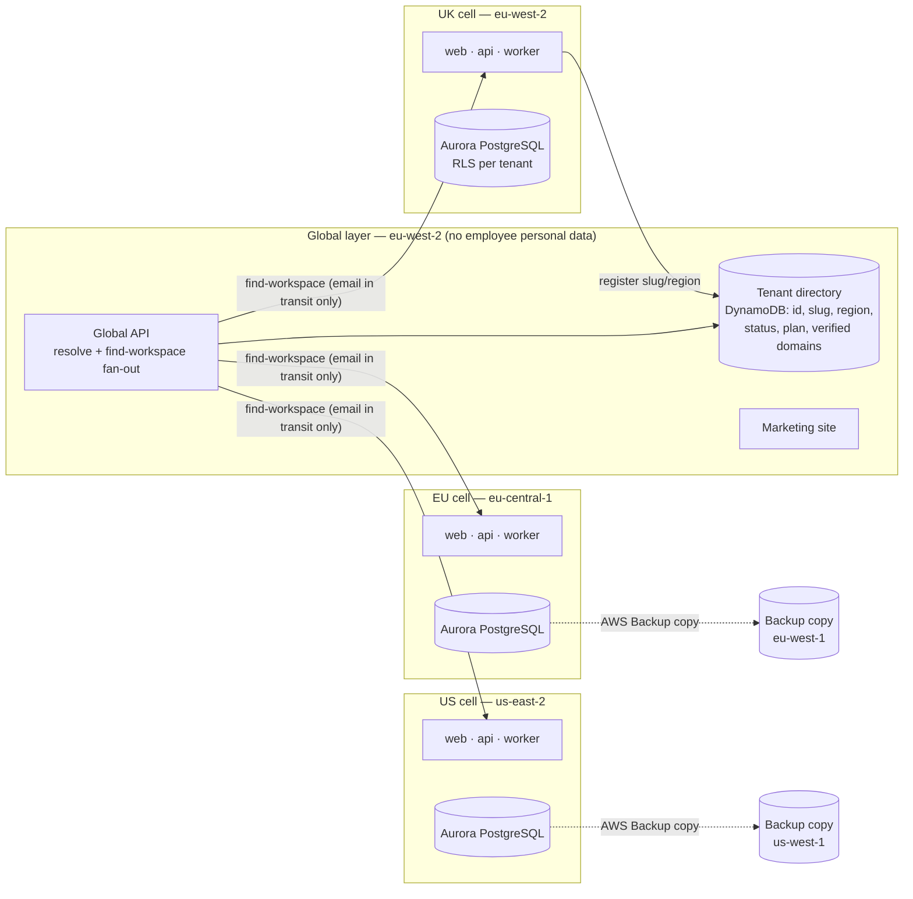
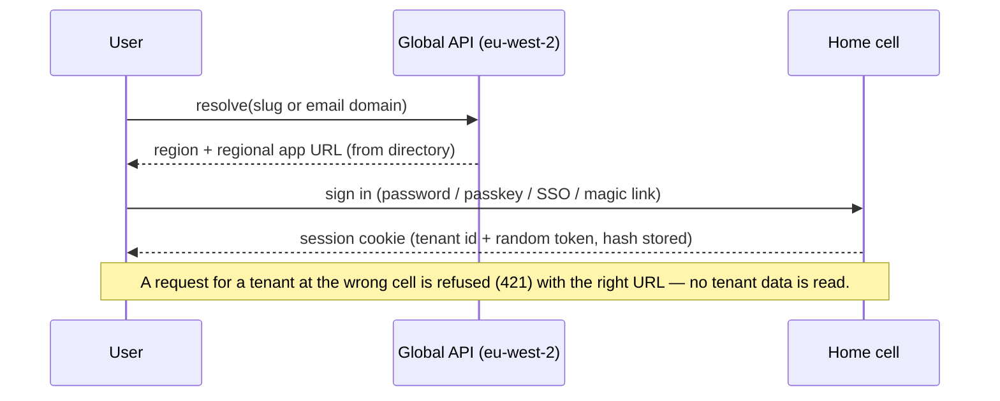
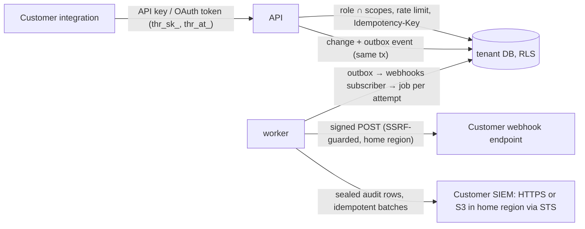

# Architecture

Thapsus-HR runs as three independent regional **cells** (UK, EU, US) and one small **global layer**. A customer's personal data lives only in its home cell. The global layer only knows which region a workspace lives in.

## 1. Regions and data residency



| Home region | AWS region | Backup copy |
| --- | --- | --- |
| UK | eu-west-2 (London) | none — London only, across availability zones |
| EU | eu-central-1 (Frankfurt) | eu-west-1 (Ireland) |
| US | us-east-2 (Ohio) | us-west-1 (N. California) |

The map lives in one module (`packages/core/src/regions.ts`). It is enforced by:

- **AWS SDK clients:** the residency-guarded factory refuses any region except the home region, plus the backup region for backup tooling.
- **Startup:** each service checks every configured endpoint (database, cache, bucket, queues, KMS, logs, backup vaults) and refuses to start if one points outside its region.
- **Router:** the tenant router treats a tenant homed in another region as unknown.
- **Tests:** CDK assertions check every stack's region and backup copy rules, and the residency test matrix covers all six region pairs.
- **Organisation SCP:** CloudFormation is never deployed to us-east-1 or us-west-2 (ADR-0001).

Authenticated pages and API responses carry `Cache-Control: private, no-store` and are served directly by the cell's load balancer. There is no CDN in front of them.

## 2. A cell

```mermaid
flowchart TB
  user((Browser / PWA\nAPI client / IdP)) --> WAF[AWS WAF] --> ALB[ALB · TLS]
  ALB -- "/v1 /scim /global" --> API[api · Fastify\nECS Fargate, autoscaling]
  ALB -- "/*" --> WEB[web · Next.js\nECS Fargate]
  API --> PROXY[RDS Proxy] --> AUR[(Aurora PostgreSQL\nwriter + reporting reader\nMulti-AZ)]
  API --> VK[(ElastiCache Valkey\nrate limits)]
  API --> S3[(S3 files\nSSE-KMS, versioned)]
  API --> KMS[KMS\ndata key + vault key]
  API --> SES[SES]
  WORKER[worker\noutbox · jobs · audit sealing] --> PROXY
  WORKER --> EB[EventBridge bus] --> SQS[SQS + DLQ]
  SCHED[EventBridge Scheduler] --> WORKER
  AUR -. continuous PITR + daily .-> BK[AWS Backup vault]
  API & WEB & WORKER --> CW[CloudWatch logs · X-Ray via ADOT\n(personal data scrubbed)]
```

## 3. Data layer

- **Tenancy:** every tenant-scoped table has `tenant_id`, composite primary keys `(tenant_id, id)`, composite foreign keys (rows cannot point across tenants), and RLS that is enabled **and forced**. One policy, `tenant_id = app.current_tenant()`, applies to every command.
- **Tenant context:** `withTenant()` sets `app.tenant_id` with `set_config(..., true)`, so the setting is transaction-local and safe with RDS Proxy pooling. The app connects as `thapsus_app`, which has no `BYPASSRLS` and owns no tables.
- **Routing:** `registry.tenants.db_key` plus the configured database map send a tenant to the shared database or a dedicated one. Moving a tenant uses `packages/db/src/move-tenant.ts` and needs no code change (runbook: `docs/runbooks/move-tenant-to-dedicated-db.md`).
- **Effective dating:** core HR records use `[valid_from, valid_to)` with exclusion constraints. `app.employees` holds denormalised *current* values for fast lists and search at 200,000 rows; a daily idempotent job refreshes them for future-dated changes.
- **Audit:** `audit.events` is append-only. Privileges and a trigger block changes, and asynchronous sealing builds a per-tenant SHA-256 chain (ADR-0004).
- **Sensitive data vault:** `vault.records` holds envelope-encrypted values with per-value data keys wrapped by the regional KMS vault key. The AAD binds each value to its tenant, subject, category and field. Every decrypt is audited.
- **Outbox:** domain events are written in the same transaction as the change. The worker dispatches them to in-process subscribers and EventBridge, exactly once per event id.

## 4. Services and packages

| Path | Role |
| --- | --- |
| `apps/web` | Next.js App Router: marketing site, app (installable PWA), sign-in and sign-up |
| `apps/api` | Fastify, OpenAPI 3.1 (`packages/sdk/openapi.json`), auth (password, TOTP, passkeys, magic links, OIDC/SAML SSO), SCIM 2.0, domain modules, global mode (`SERVICE_ROLE=global`) |
| `apps/worker` | Outbox dispatch, idempotent jobs with progress and retries, audit sealing, scheduled sweeps |
| `packages/core` | Regions, residency guard, time (Temporal), money (integer minor units), i18n catalogues and formatters, permission engine, PII scrubber, logger, tracer |
| `packages/db` | SQL migrations, tenant context, router, audit and outbox helpers, tenant move tool |
| `packages/rules` | Jurisdiction packs (versioned, effective-dated, sourced rule data, golden tests) |
| `packages/ui` | Design tokens (generated Tailwind theme) and components |
| `packages/sdk` | Published OpenAPI document and TypeScript SDK |
| `infra` | AWS CDK: cell, global and backup copy vault stacks |

## 5. Sign-in routing



"Find my workspace" fans out from the global API to every cell. Each cell looks up the email with a narrowly scoped `SECURITY DEFINER` function that returns tenant ids only, then emails the user from its own region. The global layer stores nothing.

## 6. Enterprise platform (Phase 9)



- **Public API:** API keys and OAuth clients resolve to an `api_client` principal in the context plugin. `platform/http.ts` adds per-tenant rate limits, idempotency replay and deprecation headers. The spec is the route schemas; the SDK and the `/developers` reference are generated from it (`docs/api.md`).
- **Webhooks and SIEM streams:** both are driven by the outbox and the job engine. Each attempt and each batch is idempotent. All outbound traffic goes through `lib/outbound.ts` (connect-time SSRF guard) from the tenant's home region.
- **Sandboxes:** a sandbox is a separate tenant in the same cell, built from the config-classified tables (`platform/sandbox-tables.ts`) with synthetic people.
- **Feature flags:** the registry is `packages/core/src/features.ts`, overrides are stored in `app.tenants.features->'flags'`, and the check is `featureEnabled(tx, key)`. The web shell reads `/v1/tenant/experience`.
- **Dedicated databases:** back-office move requests are run by `move-tenant --process-requests` (runbook).

## 7. Ask HR assistant (Phase 11)

```mermaid
sequenceDiagram
  participant E as Employee (web)
  participant A as API (home cell)
  participant D as Tenant DB (RLS)
  participant B as Amazon Bedrock (same region, In-Region)
  E->>A: POST /v1/ai/ask {question}
  A->>D: flag + opt-in + region check; rate limit
  A->>A: deterministic guard (decisions, injection, sensitive, colleagues)
  A->>D: directory redaction lookups; full-text + trigram retrieval over policy chunks
  A->>B: frozen system prompt + escaped excerpts + scrubbed question
  B-->>A: answer with [n] citations
  A->>A: post-model decision check; citation validation
  A->>D: ai_questions row (hash, length, outcome, cited ids) + audit (no content)
  A-->>E: answer, citations, AI disclosure
```

- **Where it runs:** only in cells with an In-Region Claude model on Bedrock (today the UK cell, eu-west-2, with Claude Opus 5.5; ADR-0110). The map lives in `packages/core/src/ai-models.ts`. The Bedrock client is built by the residency-guarded factory, and IAM allows `bedrock:InvokeModel` on that foundation model only.
- **Switches:** the staff-managed `aiAssistant` feature flag (entitlement) and the owner's opt-in, both off by default (ADR-0112).
- **Sources and index:** company documents in policy folders visible to everyone (never personal documents) are chunked into `app.ai_policy_chunks` by the idempotent `ai.index_policies` job. Retrieval is PostgreSQL full-text search plus `pg_trgm` only (ADR-0111).
- **Model interface:** `deps.ai` (`apps/api/src/modules/ai/provider.ts`): Bedrock in AWS, a deterministic fake in dev and e2e, a capturing mock in tests.
- **Code:** `apps/api/src/modules/ai` (guard, redaction, extraction, retrieval, prompt, routes), `apps/web/app/app/ask` (employees) and `apps/web/app/app/settings/ask-hr` (admins).
